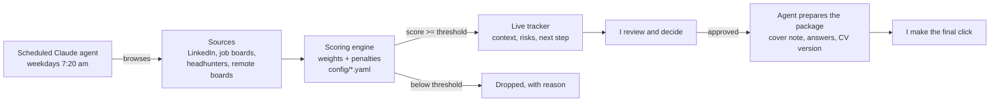

# Opportunity Radar

A small engine that turns a messy stream of opportunities into a short,
ranked list with a next step for each one. I built it with Claude to run my
own career pipeline, and the same mechanic works for B2B prospecting.

**Sources → scoring → shortlist → prepared next step.**
The people spend their time on the conversations.

## Why I built it

Finding the right opportunities meant opening tabs, reading descriptions
and deciding, every single day. The judgment was always the same
(function, industry, level, location, economics, and a few deal-breakers),
so I wrote it down once and let an agent apply it every morning.

## How it works



1. **Sweep.** A scheduled Claude agent drives a real browser session every
   weekday morning (prompt in [`prompts/daily_sweep.md`](prompts/daily_sweep.md)).
2. **Score.** Every item is scored 0-100 against a plain-language config:
   weighted dimensions plus penalty filters for known deal-breakers.
3. **Shortlist.** Anything below the threshold is dropped with the reason,
   so I can audit the filter instead of trusting it blindly.
4. **Decide and prepare.** I mark what to pursue; the agent prepares the
   package. Sending is always a human decision.

## Same engine, two use cases

| | Career pipeline | B2B prospecting |
|---|---|---|
| Config | [`config/job_search.yaml`](config/job_search.yaml) | [`config/account_prospecting.yaml`](config/account_prospecting.yaml) |
| Unit | job opening | target account |
| Dimensions | function, industry, level, location, compensation | fleet size, industry fit, spend pain, access to decision-maker, growth signals |
| Deal-breakers | B2C paid-media roles, US residency, treasury-only | competitor renewed recently, public-sector procurement |
| Output | [`examples/job_search_digest.md`](examples/job_search_digest.md) | [`examples/account_prospecting_digest.md`](examples/account_prospecting_digest.md) |

The prospecting example ranks fictional mid-market companies in Mexico for a
fuel/fleet and corporate-spend card. A sales team can change the weights in
a YAML file, rerun it and see the list reorder, with no developer involved.

## Run it

```bash
pip install -r requirements.txt
python -m radar.score --config config/job_search.yaml --data data/sample_jobs.json
python -m radar.score --config config/account_prospecting.yaml --data data/sample_accounts.json --csv shortlist.csv
python -m pytest -q
```

Sample output:

```text
## 1. Distribuidora del Bajío (fictional) — 97/100
- Fleet size: 25/25 (140 >= 50)
- Industry fit: 20/20 (logistics / distribution / field service)
- Spend pain: 22/25 (fuel control issues)
- Access to decision-maker: 15/15 (warm intro to CFO / finance director)
- Growth signals: 15/15 (new funding or new branches)
- Next step: Intro call with CFO; bring fuel-control case
```

## What I learned

- **Write the judgment down.** Most of the value came from turning gut feel
  into explicit weights and deal-breakers. Once it was written, the agent
  applies it the same way every morning.
- **Make the filter auditable.** Every dropped item carries its reason, so a
  bad rule shows up in a day instead of hiding for months.
- **Keep the last click human.** The agent researches and drafts; I decide
  and send.

## Notes

- All companies and data in this repo are fictional. My real tracker and
  accounts stay private.
- Built with [Claude](https://claude.ai) (Claude Code and scheduled agents).

---

Gerardo J. Hernández Zavala (Jerry) · [LinkedIn](https://www.linkedin.com/in/gerardojhz/)
